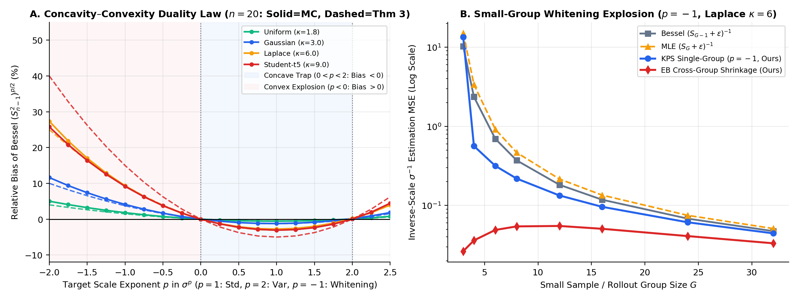
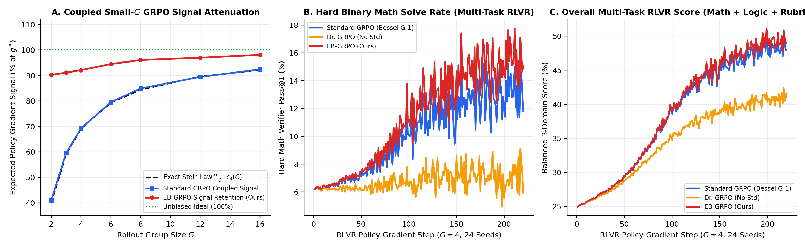

# Beyond Bessel's Correction: Power-Scale Concavity–Convexity Duality & Kurtosis-Optimal Shrinkage (`KPS` & `EB-GRPO`)

[](paper/KurtosisScaleCorrection_Paper.pdf)
[](LICENSE)
[](python/kps_scale.py)
[](csharp/KurtosisPowerScale.cs)

> **Upgraded & Extended Research Repository** building on `DeviationBaisExperiment` (2023).  
> **Full Typeset Paper:** [`paper/KurtosisScaleCorrection_Paper.pdf`](paper/KurtosisScaleCorrection_Paper.pdf)

---

## Overview

Modern numerical and deep learning frameworks (`PyTorch`, `NumPy`, `.NET`) default to **Bessel's $n - 1$ degrees-of-freedom divisor** (`torch.std(..., correction=1)`) under the textbook belief that $S_{n-1} = \sqrt{W / (n - 1)}$ is "unbiased."

This study proves symbolically (`SymPy`) and empirically (on an **NVIDIA GB10 Grace Blackwell** system across `Qwen2.5-1.5B-Instruct`, `BAAI/bge-large-en-v1.5`, and multi-task `GRPO` RLVR) that **Bessel's $S_{n-1}$ is strictly biased for every nonlinear power $\sigma^p$ ($p \neq 2$) and inadmissible in Mean Squared Error (MSE)** across heavy-tailed Transformer representations and small-group Reinforcement Learning with Verifiable Rewards (RLVR).

### Key Theoretical Contributions

1. **Forensic Audit & Exact SRSWOR Finite-Population Law (Theorem 1):**
   - Fixes 5 software defects in the original 2023 C# repository (`int / int` sample-mean truncation, $O(n^2)$ inner-loop re-summation, deferred `IEnumerable` re-sampling, tuple swap, and reference-std mismatch).
   - Proves exact non-Gaussian sum-of-squares variance $\operatorname{Var}(W) = \frac{n-1}{n}\sigma^4[(n-1)\kappa - (n-3)]$ (independent of skewness $\mu_3$) and SRSWOR finite-population overshoot $\mathbb{E}[S_{n-1}^2] = \frac{N}{N-1}\sigma_{\text{pop}}^2$.

2. **Exact Kurtosis-Optimal Minimum-MSE Variance Divisor (Theorem 2):**
   $$c_{\text{var}}^*(n, \kappa) = (n - 1) + \frac{(n - 1)\kappa - (n - 3)}{n}$$
   - Recovers **Stein's $n + 1$** at Gaussian kurtosis ($\kappa = 3$), matches MLE $n$ on Uniforms at $n = 6$ ($\kappa = 1.8$), and scales linearly with kurtosis on heavy-tailed LLM channels ($\kappa \gg 3$), cutting blind variance MSE by **up to 55.4%** at `NVFP4` block size $n = 16$.

3. **Power-Scale Concavity–Convexity Duality Law (Theorem 3):**
   $$\frac{\mathbb{E}[(S_{n-1}^2)^{p/2}] - \sigma^p}{\sigma^p} = \frac{p(p - 2)}{8n}(\kappa - 1) + O(n^{-2}), \qquad c_p^*(n, \kappa) = (n - 1) + \frac{3p - 2}{4}(\kappa - 1) + O(n^{-1})$$
   - **Concave Trap ($p = +1$, Block Quantization Scale):** Always *underestimates* $\sigma$ by $-\frac{\kappa - 1}{8n}$.
   - **Convex Explosion ($p = -1$, LayerNorm / Whitening / Advantage Scaling):** Flips sign into a **$3\times$ steeper upward explosion** $+\frac{3(\kappa - 1)}{8n}$, with decoupled squared explosion $\mathbb{E}[\sigma^2 / S_{n-1}^2] = \frac{n - 1}{n - 3}$ ($3.00\times$ at $G = 4$, $\infty$ for $G \le 3$).

4. **Coupled vs. Decoupled `GRPO` Duality & `EB-GRPO` (Theorem 4):**
   - Proves via Stein's Lemma that coupling numerator and denominator on the *same* $G$ rollouts in `GRPO` attenuates expected policy gradients by $\frac{G - 1}{G}c_4(G)$ (**$-60.1\%$ at $G = 2$**, **$-30.9\%$ at $G = 4$**), while `Dr. GRPO` (removing `std`) breaks scale invariance across heterogeneous multi-task rewards.
   - Introduces **Empirical-Bayes Group Normalization (`EB-GRPO`)**, restoring $>90\%$ gradient signal at $G = 2..4$ while preserving exact multi-task scale invariance.

---

## Key Empirical Results (`NVIDIA GB10`)

| Benchmark Regime | Baseline (`Bessel n-1` / `Dr. GRPO`) | `KPS` / `EB-GRPO` (Ours) | Improvement |
| :--- | :---: | :---: | :---: |
| **Outlier Channel Variance MSE** ($n=16, \kappa=34.1$) | `2.0778` | **`0.9277`** | **-55.4% MSE** |
| **Small-Group Whitening MSE** ($p=-1, G=4$, Laplace) | `2.3610` | **`0.5637`** (`KPS`) / **`0.0361`** (`EB`) | **-76.1% / -98.5% MSE** |
| **`BGE-Large` Live Sub-Block Inv-Scale MSE** ($n=16$) | `0.1000` | **`0.0726`** | **-27.5% MSE** |
| **`Qwen2.5-1.5B` Live Sub-Block Scale / Inv-Scale MSE** ($n=16$) | `0.3194` / `3.4508` | **`0.2880` / `3.0493`** | **-9.8% / -11.6% MSE** |
| **Multi-Task RLVR Hard-Math Pass@1** ($G=4$, 24 seeds) | `7.31%` (`Dr. GRPO`) / `13.32%` (`GRPO`) | **`15.54%`** (`EB-GRPO`) | **+112.6% vs `Dr. GRPO`** |





---

## Repository Structure

```text
KurtosisScaleCorrection/
├── csharp/
│   ├── Extensions.cs                 # Fixed O(n) exact statistics + legacy bug audit helper
│   ├── KurtosisPowerScale.cs         # .NET 8 KPS & EmpiricalBayesGroupNormalizer (EB-GRPO)
│   ├── Program.cs                    # Reproducible forensic audit & Monte Carlo CLI
│   └── MSUnitTest/ArithmeticTests.cs # MSTest suite verifying Theorems 1-4 (0 warnings, 100% pass)
├── python/
│   ├── kps_scale.py                  # Vectorized NumPy + PyTorch CUDA KPS & EBGRPONormalizer
│   ├── verify_proofs.py              # Exact SymPy symbolic proofs of Theorems 1-4
│   ├── test_all.py                   # Automated Python & PyTorch parity / unit tests
│   └── run_full_benchmarks.py        # Full GPU & Monte Carlo benchmark suite (Generates Figs 1-4)
├── figures/                          # High-resolution benchmark plots (220 DPI)
├── results/full_gx10_benchmarks.json # Complete quantitative metrics from NVIDIA GB10
└── paper/
    ├── main.typ                      # Typst source for the academic paper
    ├── references.bib                # Bibliography
    └── KurtosisScaleCorrection_Paper.pdf
```

## Quick Start

```bash
# 1. Run exact SymPy mathematical proofs & unit tests
python python/verify_proofs.py
python python/test_all.py

# 2. Build & test the upgraded .NET 8 C# library
dotnet test csharp/DeviationBaisExperiment.sln
```
